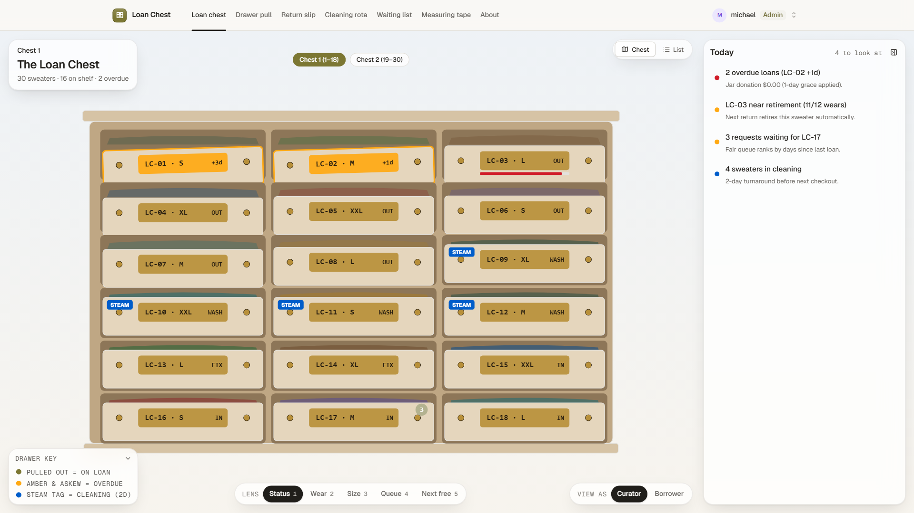

# Loan Chest

A holiday loaner sweater lending library: reserve a sweater that fits your chest ease, enforce a 2-day cleaning turnaround between loans, resolve contested dates with a fair priority queue, track charity-jar lateness donations, and retire worn-out garments automatically.




## This repository

```text
apps/loan-chest/   the app: React + Vite frontend, Rayfin data model (rayfin/), tests, demo walkthrough
shared/         shared package (@x10/shared): data store, sign-in runtime, UI kit, charts
tools/          deploy, seed, SQL and secrets-check scripts
```

Quick start (no Fabric tenant needed, runs in demo mode with sample data):

```bash
npm install
npm run dev
```

## The problem & rules

Shared office loaner cupboards fail when garments return unwashed, regulars hog the best knits, and nobody knows what fits. Loan Chest encodes five deterministic library rules: 4-day maximum loan with a 2-day cleaning turnaround gap, chest-ease fit matching (`0–20 cm`, ranked by closeness to `10 cm`), fair queue priority (`min(daysSinceLastLoan, 60)`, never-borrowed = `60`), one 2-day extension when uncontested plus `$1.00/day` charity-jar donation after 1 grace day, and automatic retirement at 12 wears or a second damaged return.

## What it looks like

The home centrepiece is a **tall wooden chest of drawers** (SVG): three columns of six drawers per chest (with Chest 1 / Chest 2 tabs for 30 sweaters). Each drawer carries a brass tag (`LC-01 · S`), a folded sweater lip in its deterministic knit colour, slide-out depth proportional to loan progress, amber askew tilt when overdue, a `STEAM` tag during cleaning, a crossed-out label when retired, and a queue badge. Switch between five lenses (`Status`, `Wear`, `Size`, `Queue`, `Next free`), toggle **View As** (Curator / Borrower fit glow), or open the accessible **List** view. Tools: **Drawer pull**, **Return slip**, **Cleaning rota**, **Waiting list**, and **Measuring tape**.

## Prerequisites

- Microsoft Fabric Apps workload in a workspace on a capacity
- Edit permission on the workspace
- Node.js 20+

## Run locally

```bash
npm install # at repo root
cd apps/loan-chest
npm run dev        # demo mode with deterministic seed & persona switcher (port 5248)
npm run dev:fabric # connected to Microsoft Fabric
```

## Deploy

```bash
npx rayfin up --workspace-id <your-workspace-id>
```

## Seed & admin setup

```bash
npm run seed:fabric -- --admin-email you@org.com
```

The first persona (`Alex Rivera`) is the curator/admin in demo mode.

## How it works

| Entity | Purpose | Row security |
| --- | --- | --- |
| `Loaner` | Sweater tag, size, chest cm, fibre, wears, status | Read: authenticated; Write: `claims.sub.eq(item.curatorSub)` |
| `Loan` | Reservation / active loan / return condition | Read: authenticated; Create: `claims.sub.eq(item.borrowerSub)`; Update/Delete: borrower or curator |
| `BorrowerProfile` | Borrower chest measurement and last loan date | Read: authenticated; Write: `claims.sub.eq(item.personSub)` |

## Known limits

- Cleaning turnaround overlap checks, 4-day max length, extension conflict checks, and automatic retirement transitions are enforced in domain functions (`src/domain/store.ts`) because Rayfin's row-policy DSL does not express cross-row date interval queries.

## Later

- Barcode/QR check-in scanner for physical garment tags
- Dry-cleaning vendor batch export

## Gallery

**Title:** 12 Days of Fabric Apps: Day 2.6 – Loan Chest

**Blurb:** Turn the office ugly-sweater cupboard into a proper lending library. Loan Chest displays thirty loaner knits in a tall wooden chest of drawers: drawers slide out as loans progress, tilt amber when overdue, carry a steam tag during the two-day cleaning turnaround, and glow for borrowers whose chest ease fits. A fair priority queue puts never-borrowed colleagues first, and garments retire automatically on their twelfth return. Built with Microsoft Fabric Apps by Datachain Consulting for AI at Work.

**Tags:** `Partner | 12 Days of Fabric Apps`

## License

MIT. See [LICENSE](LICENSE).
